<div align="center">

# MTVA-Bench

**How well can an LLM run a real phone call?**

The Multi-Turn Voice Agent Benchmark: production-style voice agents, whole simulated calls, ten languages.

[](LICENSE) [](pyproject.toml) [](#the-test-set-stays-private)

</div>

In a cascaded voice agent (speech-to-text, then an LLM, then text-to-speech), the LLM decides
everything the caller hears and every action the business takes. MTVA-Bench puts that LLM where
production puts it: a long system prompt full of business rules, real tools to look things up
and act, and a caller with their own goal, facts and patience. A simulated caller holds a whole
call with it, from greeting to hang-up, and a judge reads the call to score how the agent did.

**600 calls · 100 agents · 29 industries · 10 languages · inbound and outbound**

Every model gets an **MTVA Score** from 0 to 100. It is the average of four things the judge
checks on each call: whether the caller got what they called for, whether the agent used its
tools correctly, whether it kept to its instructions, and whether what it said was true. The
benchmark also measures how quickly each model replies, what a call costs, and how human the
agent sounds.

MTVA-Bench is built and run by [Smallest AI](https://smallest.ai), which also makes Electron,
the model highlighted in the charts. Every model takes the same test under the same conditions;
[How a run works](#how-a-run-works) gives the details.

## Quality against speed

A voice agent has to be good and fast. On a call, a long pause before the agent answers is the
first thing a caller notices. The chart places every model by its MTVA Score and by how quickly
it starts to reply. The line is the Pareto frontier: the models that no other model beats on
both.

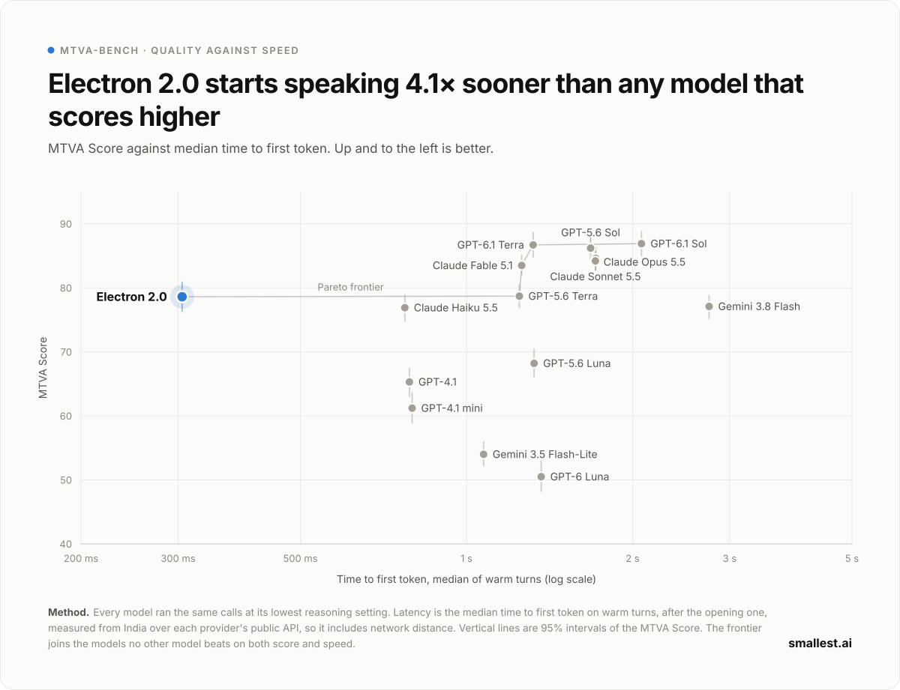

## The MTVA Index

A voice agent needs three things at once: to handle the call well, to answer quickly, and to
cost little enough to run on every call. A cheap model that handles calls badly is no use, and
neither is a strong one that keeps the caller waiting. The MTVA Index puts the three into one
number from 0 to 100. Quality is the MTVA Score, speed is the time to first token, and cost is
what one call costs: the tokens the model used on it, at its provider's list price.

<!-- mtva:index -->
The index is a weighted geometric mean: the MTVA Score counts for 50%, speed for 30% and cost for 20%, and a strong part cannot make up for a poor one.
<!-- /mtva:index -->
The weights are our judgement of what a live call needs, so each model's three measured values
sit beside its index for you to weigh your own way.

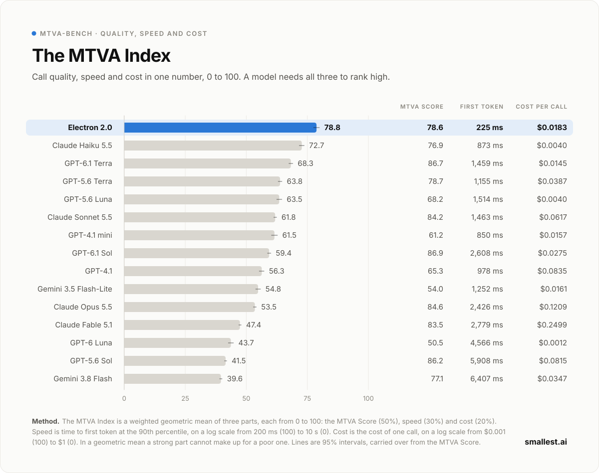

## Time to first sentence

In a cascaded voice agent, text-to-speech can start only once the first complete sentence
arrives, so that is the moment the caller first hears the agent. The chart shows that moment
for every model, with a tick where its first token arrived.

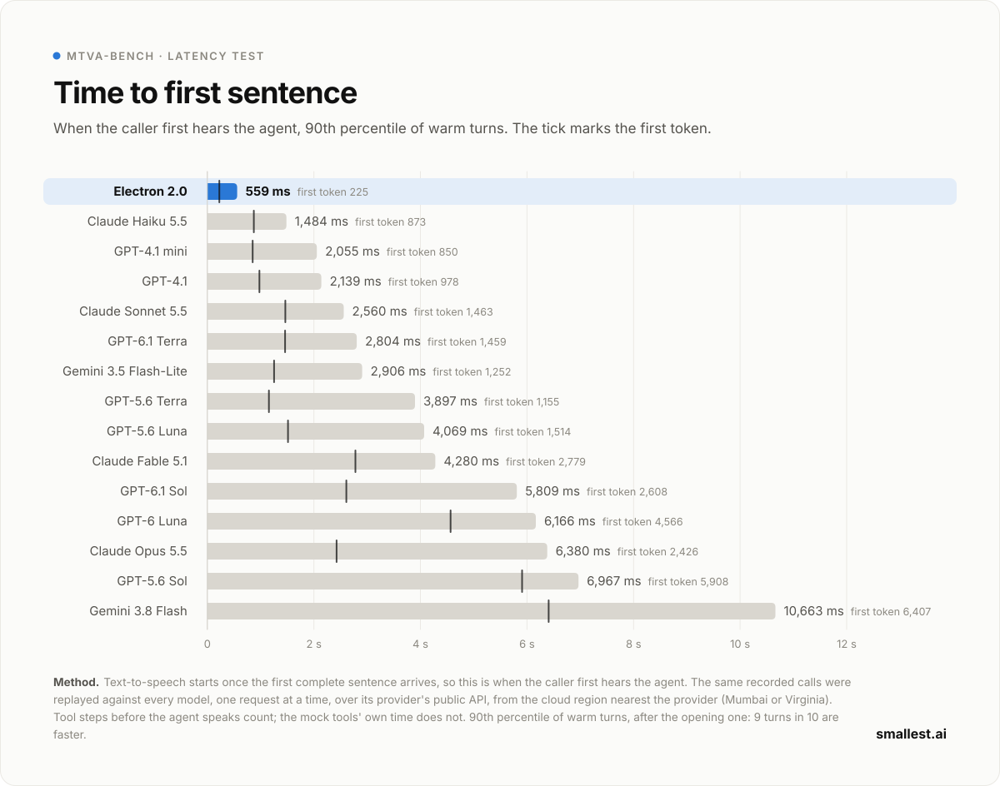

## Sounds human

A caller judges an agent first by how it sounds. In a blind head-to-head, a judge reads the same
scenario handled by two models, shown only as what each agent said aloud: no system prompt, tools
or model names. It picks the agent a caller would more readily take for a skilled person.
Each model's call is shown first in half of the scenarios, so a lean toward either position
cancels out. The chart shows how often Electron 2.0 was picked against each model it was paired
with. This comparison sits outside the MTVA Score.

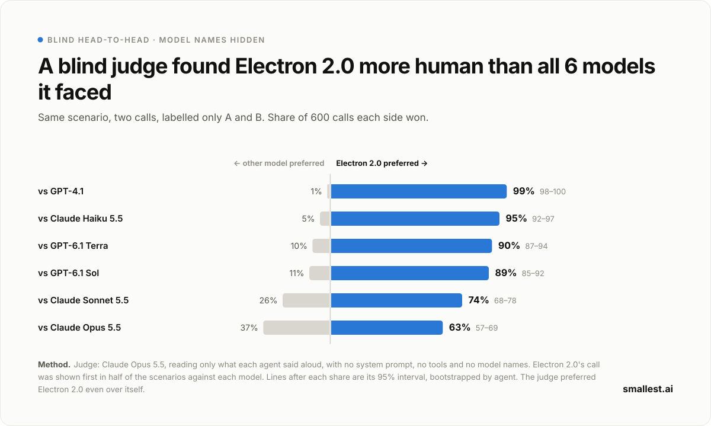

## Leaderboard

<!-- mtva:table -->
| # | Model | Reasoning | MTVA Score | First token (ms) | First sentence (ms) | Cost per call | MTVA Index |
| :-: | :-- | :-- | --: | --: | --: | --: | --: |
| 1 | GPT-6.1 Sol | low | 86.9 | 1,473&nbsp;/&nbsp;2,608 | 2,331&nbsp;/&nbsp;5,809 | $0.0275 | 59.4 |
| 2 | GPT-6.1 Terra | none | 86.7 | 1,042&nbsp;/&nbsp;1,459 | 1,612&nbsp;/&nbsp;2,804 | $0.0145 | 68.3 |
| 3 | GPT-5.6 Sol | none | 86.2 | 1,690&nbsp;/&nbsp;5,908 | 2,239&nbsp;/&nbsp;6,967 | $0.0815 | 41.5 |
| 4 | Claude Opus 5.5 | low | 84.6 | 1,232&nbsp;/&nbsp;2,426 | 2,159&nbsp;/&nbsp;6,380 | $0.1209 | 53.5 |
| 5 | Claude Sonnet 5.5 | none | 84.2 | 1,088&nbsp;/&nbsp;1,463 | 1,382&nbsp;/&nbsp;2,560 | $0.0617 | 61.8 |
| 6 | Claude Fable 5.1 | low | 83.5 | 866&nbsp;/&nbsp;2,779 | 1,888&nbsp;/&nbsp;4,280 | $0.2499 | 47.4 |
| 7 | GPT-5.6 Terra | none | 78.7 | 805&nbsp;/&nbsp;1,155 | 1,489&nbsp;/&nbsp;3,897 | $0.0387 | 63.8 |
| 8 | **Electron 2.0** | none | **78.6** | **169&nbsp;/&nbsp;225** | **327&nbsp;/&nbsp;559** | **$0.0183** | **78.8** |
| 9 | Gemini 3.8 Flash | low | 77.1 | 2,499&nbsp;/&nbsp;6,407 | 3,156&nbsp;/&nbsp;10,663 | $0.0347 | 39.6 |
| 10 | Claude Haiku 5.5 | none | 76.9 | 587&nbsp;/&nbsp;873 | 833&nbsp;/&nbsp;1,484 | $0.0040 | 72.7 |
| 11 | GPT-5.6 Luna | none | 68.2 | 837&nbsp;/&nbsp;1,514 | 1,324&nbsp;/&nbsp;4,069 | $0.0040 | 63.5 |
| 12 | GPT-4.1 | none | 65.3 | 646&nbsp;/&nbsp;978 | 860&nbsp;/&nbsp;2,139 | $0.0835 | 56.3 |
| 13 | GPT-4.1 mini | none | 61.2 | 592&nbsp;/&nbsp;850 | 793&nbsp;/&nbsp;2,055 | $0.0157 | 61.5 |
| 14 | Gemini 3.5 Flash-Lite | minimal | 54.0 | 864&nbsp;/&nbsp;1,252 | 1,197&nbsp;/&nbsp;2,906 | $0.0161 | 54.8 |
| 15 | GPT-6 Luna | none | 50.5 | 1,139&nbsp;/&nbsp;4,566 | 1,842&nbsp;/&nbsp;6,166 | $0.0012 | 43.7 |
<!-- /mtva:table -->

The table is ordered by MTVA Score. The MTVA Score and the MTVA Index run from 0 to 100. First
token and first sentence are the median and the 90th percentile, in milliseconds, over warm
turns in the latency test. Cost per call is in US dollars. Reasoning is the setting each model
ran at.
[What it measures](#what-it-measures) breaks the score down, and
[How a run works](#how-a-run-works) explains each number.

## What it measures

Four capabilities, weighted equally, make the MTVA Score. One judge reads each call once and
files every problem under exactly one of them, so nothing is counted twice.

<!-- mtva:capabilities -->
| # | Model | MTVA Score | Task completion | Tool calling | Instruction following | Faithfulness |
| :-: | :-- | --: | --: | --: | --: | --: |
| 1 | GPT-6.1 Sol | 86.9 | 83.8 | 85.6 | 80.1 | 98.3 |
| 2 | GPT-6.1 Terra | 86.7 | 83.8 | 85.6 | 79.3 | 98.1 |
| 3 | GPT-5.6 Sol | 86.2 | 86.1 | 85.7 | 78.4 | 94.6 |
| 4 | Claude Opus 5.5 | 84.6 | 81.8 | 92.6 | 68.4 | 95.6 |
| 5 | Claude Sonnet 5.5 | 84.2 | 86.9 | 90.8 | 66.0 | 93.4 |
| 6 | Claude Fable 5.1 | 83.5 | 83.5 | 91.0 | 68.3 | 91.3 |
| 7 | GPT-5.6 Terra | 78.7 | 80.2 | 77.2 | 64.2 | 93.3 |
| 8 | **Electron 2.0** | **78.6** | 83.0 | 81.5 | 66.9 | 83.1 |
| 9 | Gemini 3.8 Flash | 77.1 | 79.8 | 81.5 | 60.4 | 86.5 |
| 10 | Claude Haiku 5.5 | 76.9 | 83.2 | 79.8 | 59.0 | 85.8 |
| 11 | GPT-5.6 Luna | 68.2 | 72.2 | 62.5 | 48.1 | 90.2 |
| 12 | GPT-4.1 | 65.3 | 72.2 | 69.4 | 45.1 | 74.4 |
| 13 | GPT-4.1 mini | 61.2 | 65.5 | 61.8 | 43.8 | 73.8 |
| 14 | Gemini 3.5 Flash-Lite | 54.0 | 56.0 | 51.5 | 32.3 | 76.2 |
| 15 | GPT-6 Luna | 50.5 | 45.2 | 31.1 | 30.5 | 95.1 |
<!-- /mtva:capabilities -->

Each capability has its own chart below, with every model's 95% interval.

### Task completion

Did the caller get what they called for? The outcome of the call, judged from the caller's side:
reached, an alternative the caller accepted, partly reached, not reached, or a wrong result.

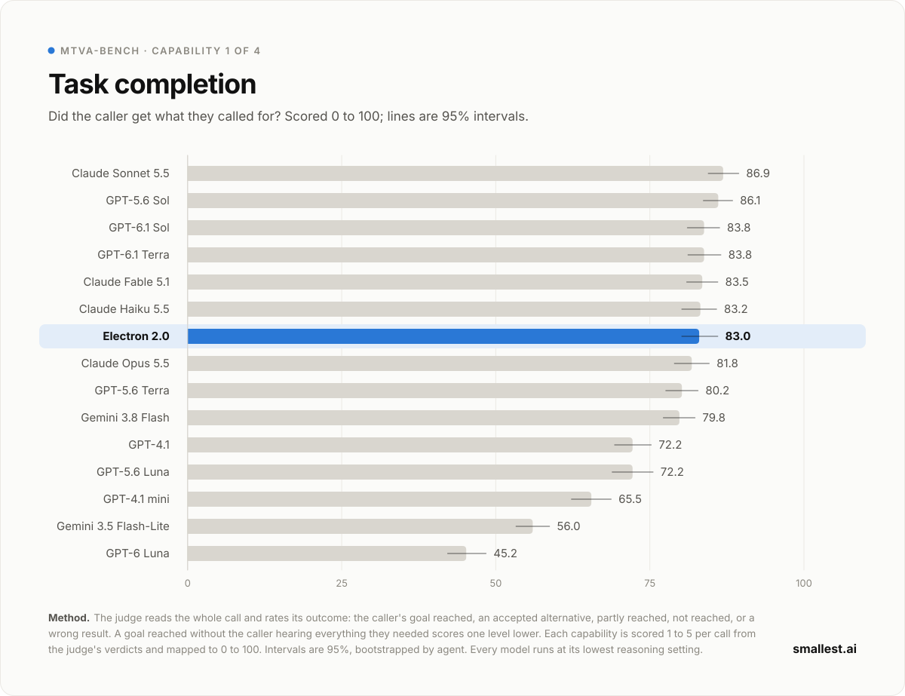

### Tool calling

Did the agent look things up and act the way the business needs: the right tool, the right
arguments, the right order? Each scenario's key actions are checked in code first, then by the
judge.

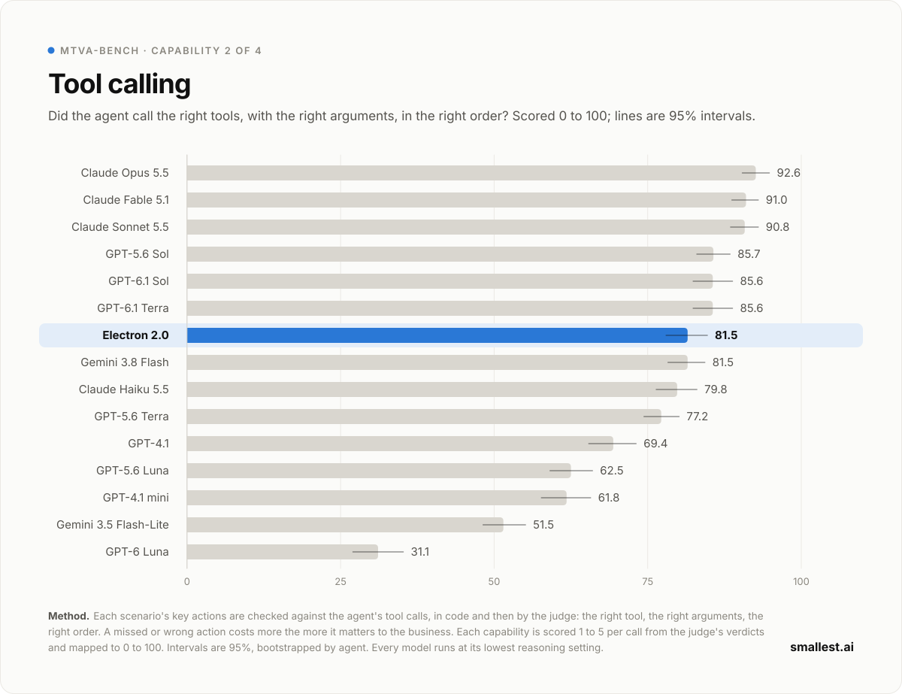

### Instruction following

Did the agent keep to the rules of its system prompt, the ones a real deployment depends on:
verification before disclosure, scripts that must be read, what never to promise, how to end a
call?

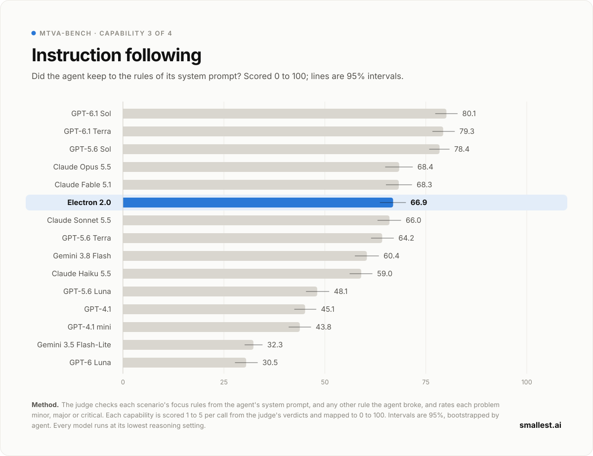

### Faithfulness

Was everything the agent said true? Facts that came from nowhere, actions claimed but never run,
and details that contradict the tools or the caller are all counted here.

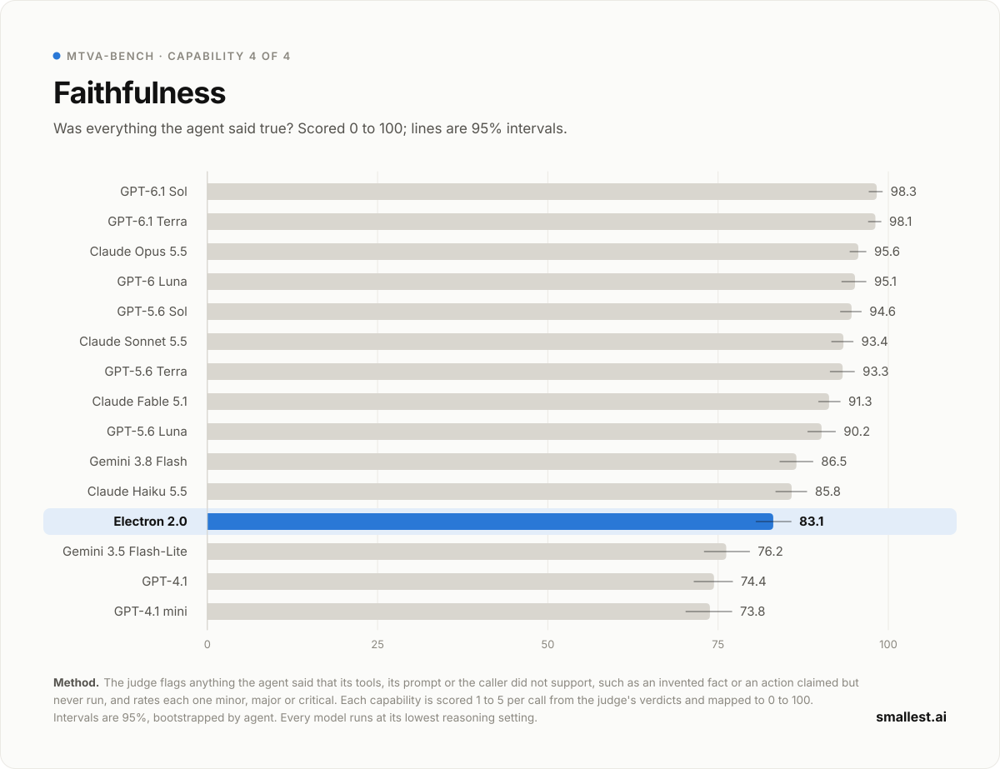

## Across languages

Agents speak the caller's language as a local customer-service team would, in native script with
the English words people really mix in. The judge holds every agent to the language and register
its system prompt sets. The chart shows each model's MTVA Score in each of the ten languages.

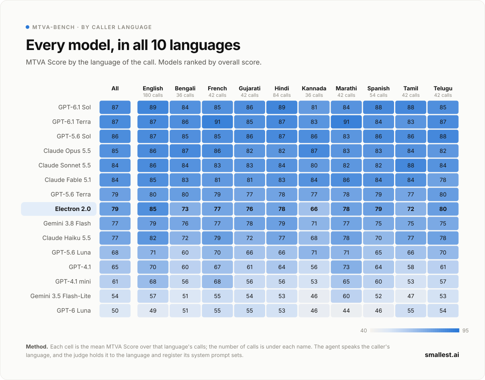

## The MTVA Score

The four capabilities in one number: their mean, for every model.

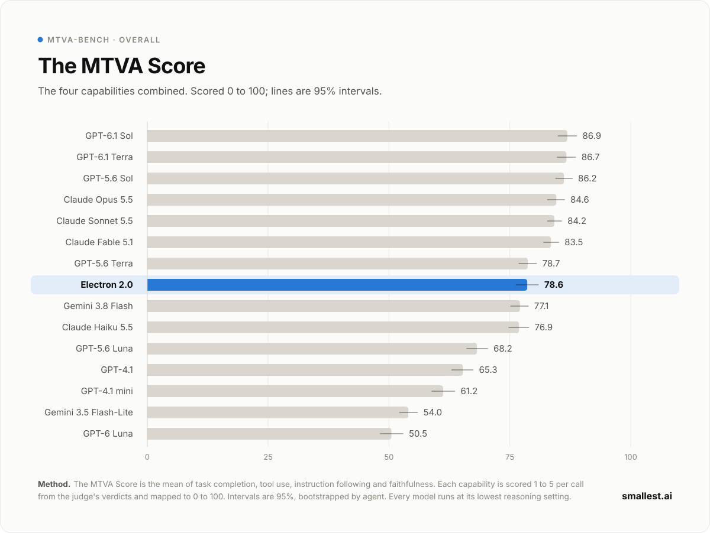

## How a run works

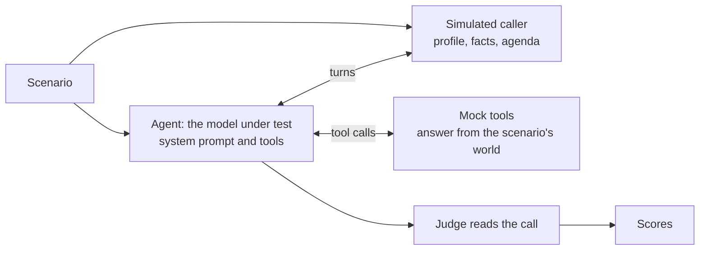

1. **Scenarios.** Each of the 100 agents is a production-style system prompt, about 16,000
   characters at the median, with 4 to 19 tools. Each of its six scenarios adds a caller with a
   profile, the facts they know and an agenda; a world the tools answer from; and the grading:
   the key actions the call needs, the prompt rules it tests, and the outcome it should reach.
2. **The call.** The model under test talks to a simulated caller for up to 30 turns. The caller
   is the same person for every model, with the same facts and agenda, and gives no hints. Tools
   are answered deterministically from the scenario. The call ends when the agent hangs up or
   transfers, or when the caller is done.
3. **The judge.** Claude Opus 5.5 reads the whole call, the tool log and the agent's system
   prompt, and gives verdicts and severities: whether each rule was followed, whether each key
   action was met, what went wrong and how badly. Code turns the verdicts into a 1-to-5 score per
   capability, so two runs of the judge agree far more often than if it picked scores itself.
4. **The score.** Each capability maps to 0 to 100 and the MTVA Score is their mean. Intervals
   come from a bootstrap that resamples agents, since calls to one agent rise and fall together.
5. **Latency.** A separate test replays the same recorded calls against every model, one request
   at a time, over each provider's public API. It runs from the cloud region nearest that
   provider, Virginia for the models hosted in the US and Mumbai for Electron, so network
   distance adds as little as it can.
6. **Cost and the MTVA Index.** The tokens a model used on its scored calls are priced at its
   provider's list price, with input read from or written to the prompt cache at those rates,
   and averaged per call. The MTVA Index scores speed and cost from 0 to 100 on log scales
   between fixed ends, then combines them with the MTVA Score. The ends are fixed numbers, not
   the best and worst model, so a new model never changes another's index.

**Fairness.** Every model meets the same caller, the same judge and the same settings, and runs
at the lowest reasoning setting it accepts, which is how it would be run on a live call. A model
that cannot speak and call a tool in one message says its goodbye inside the end-call tool, and
the judge does not count the silence around its tool calls against it.

## The test set stays private

The MTVA-Bench data is held privately so its scores stay meaningful for future models.
Everything that decides a score is public: the caller's prompt, the judge's prompts, the scoring
code and every published result. Each result records the hashes of the data, caller, judge and
prompts it was made with, and `benchmark.yaml` pins the data's SHA-256.

## Running it

```bash
uv sync                      # or: pip install -e .
cp .env.example .env         # one API key per provider, plus HF_TOKEN for the data
```

A model is one YAML file in `models/`: the provider, the model id, its settings and how it is
named on the leaderboard. A self-hosted model uses `provider: custom` with a `base_url`.

```yaml
name: my-model
display:
  label: My Model
  organization: My Lab
  reasoning: none
provider: custom
model: my-org/my-model
base_url: https://my-endpoint.example.com/v1
api_key_env: MY_API_KEY
serving:
  kind: self-hosted
```

```bash
# simulate the calls, judge them and score the run; run again to resume
mtva-bench run models/my-model.yaml

# compare two runs, and ask which one sounds more human
mtva-bench report runs/my-model runs/gpt-6.1-sol --by language
mtva-bench arena runs/my-model runs/gpt-6.1-sol --batch

# publish the run's summary, its latency test and its cost per call
mtva-bench publish runs/my-model
mtva-bench latency models/my-model.yaml --region us-east-1 --publish
mtva-bench cost runs/my-model --prices prices.yaml --publish

# rebuild leaderboard.json, the charts and this README
mtva-bench leaderboard
```

- **Resuming.** Every stage saves as it goes, so an interrupted run picks up where it stopped
  and never pays twice for the same call.
- **Batch judging.** `--batch` judges through the provider's batch API at half the price.
- **Cost.** `mtva-bench cost` reads a price file you write: US dollars per million tokens for
  each run's input, cached input, cache writes and output. Prices change, so the file is not
  part of the benchmark; only the resulting cost per call is published.

## Citation

```bibtex
@misc{mtvabench2026,
  title  = {MTVA-Bench: The Multi-Turn Voice Agent Benchmark},
  author = {{Smallest AI}},
  year   = {2026},
  url    = {https://github.com/smallest-inc/mtva-bench}
}
```

## License

Apache 2.0. See [LICENSE](LICENSE).
