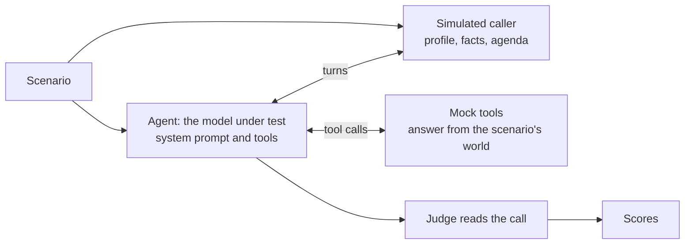

<div align="center">

# MTVA-Bench

**How well can an LLM run a real phone call?**

The Multi-Turn Voice Agent Benchmark: production-style voice agents, whole simulated calls, ten languages.

[](LICENSE) [](pyproject.toml) [](#the-test-set-stays-private)

</div>

In a cascaded voice agent (speech-to-text, then an LLM, then text-to-speech), the LLM decides
everything the caller hears and every action the business takes. MTVA-Bench puts that LLM where
production puts it: a long system prompt full of business rules, real tools to look things up
and act, and a caller with their own goal, facts and patience. A simulated caller holds a whole
call with it, from greeting to hang-up, and a judge reads the call to score how the agent did.

**600 calls · 100 agents · 29 industries · 10 languages · inbound and outbound**

<!-- mtva:highlights -->
- **Fastest to respond:** 305 ms median time to first token, 2.5× sooner than the next fastest model, Claude Haiku 5.5 (773 ms).
- **Sounds the most human:** a blind judge preferred it over all 6 models it faced, in 63% to 99% of calls, including Claude Opus 5.5, the judge itself.
- **Quality at speed:** an MTVA Score of 78.6; every model that scores higher takes at least 4.1× as long to start speaking.
<!-- /mtva:highlights -->


## Leaderboard

<!-- mtva:table -->
| # | Model | Reasoning | MTVA Score | Task | Tools | Instructions | Faithfulness | First token |
|:-:|:--|:--|--:|--:|--:|--:|--:|--:|
| 1 | GPT-6.1 Sol | low | 86.9 | 83.8 | 85.6 | 80.1 | 98.3 | 2,076 ms |
| 2 | GPT-6.1 Terra | none | 86.7 | 83.8 | 85.6 | 79.3 | 98.1 | 1,321 ms |
| 3 | GPT-5.6 Sol | none | 86.2 | 86.1 | 85.7 | 78.4 | 94.6 | 1,679 ms |
| 4 | Claude Opus 5.5 | low | 84.6 | 81.8 | 92.6 | 68.4 | 95.6 | 1,715 ms |
| 5 | Claude Sonnet 5.5 | none | 84.2 | 86.9 | 90.8 | 66.0 | 93.4 | 1,713 ms |
| 6 | Claude Fable 5.1 | low | 83.5 | 83.5 | 91.0 | 68.3 | 91.3 | 1,259 ms |
| 7 | GPT-5.6 Terra | none | 78.7 | 80.2 | 77.2 | 64.2 | 93.3 | 1,247 ms |
| 8 | **Electron 2.0** | none | **78.6** | 83.0 | 81.5 | 66.9 | 83.1 | **305 ms** |
| 9 | Gemini 3.8 Flash | low | 77.1 | 79.8 | 81.5 | 60.4 | 86.5 | 2,754 ms |
| 10 | Claude Haiku 5.5 | none | 76.9 | 83.2 | 79.8 | 59.0 | 85.8 | 773 ms |
| 11 | GPT-5.6 Luna | none | 68.2 | 72.2 | 62.5 | 48.1 | 90.2 | 1,326 ms |
| 12 | GPT-4.1 | none | 65.3 | 72.2 | 69.4 | 45.1 | 74.4 | 788 ms |
| 13 | GPT-4.1 mini | none | 61.2 | 65.5 | 61.8 | 43.8 | 73.8 | 797 ms |
| 14 | Gemini 3.5 Flash-Lite | minimal | 54.0 | 56.0 | 51.5 | 32.3 | 76.2 | 1,074 ms |
| 15 | GPT-6 Luna | none | 50.5 | 45.2 | 31.1 | 30.5 | 95.1 | 1,366 ms |
<!-- /mtva:table -->

Scores run from 0 to 100; the charts below show each one's 95% interval. First token is the
median time to the first token on warm turns. Every model runs at the lowest reasoning setting it accepts. [How a run
works](#how-a-run-works) explains each number.

## What it measures

Four capabilities, weighted equally, make the MTVA Score. One judge reads each call once and
files every problem under exactly one of them, so nothing is counted twice.

### Task completion

Did the caller get what they called for? The outcome of the call, judged from the caller's side:
reached, an alternative the caller accepted, partly reached, not reached, or a wrong result.


### Tool calling

Did the agent look things up and act the way the business needs: the right tool, the right
arguments, the right order? Each scenario's key actions are checked in code first, then by the
judge.


### Instruction following

Did the agent keep to the rules of its system prompt, the ones a real deployment depends on:
verification before disclosure, scripts that must be read, what never to promise, how to end a
call?


### Faithfulness

Was everything the agent said true? Facts that came from nowhere, actions claimed but never run,
and details that contradict the tools or the caller are all counted here.


## Sounds human

A caller judges an agent first by how it sounds. In a blind head-to-head, a judge reads the same
scenario handled by two models, shown only as what each agent said aloud: no system prompt, tools
or model names. It picks the agent a caller would more readily take for a skilled person.
Each model's call is shown first in half of the scenarios, so a lean toward either position
cancels out. This comparison sits outside the MTVA Score.


## Across languages

Agents speak the caller's language as a local customer-service team would, in native script with
the English words people really mix in. The judge holds every agent to the language and register
its system prompt sets.


## The MTVA Score


## How a run works



1. **Scenarios.** Each of the 100 agents is a production-style system prompt, about 16,000
   characters at the median, with 4 to 15 tools. Each of its scenarios adds a caller with a
   profile, the facts they know and an agenda; a world the tools answer from; and the grading:
   the key actions the call needs, the prompt rules it tests, and the outcome it should reach.
2. **The call.** The model under test talks to a simulated caller for up to 30 turns. The caller
   is the same person for every model, with the same facts and agenda, and gives no hints. Tools are answered
   deterministically from the scenario. The call ends when the agent hangs up or transfers, or
   when the caller is done.
3. **The judge.** Claude Opus 5.5 reads the whole call, the tool log and the agent's system
   prompt, and gives verdicts and severities: whether each rule was followed, whether each key
   action was met, what went wrong and how badly. Code turns the verdicts into a 1-to-5 score per
   capability, so two runs of the judge agree far more often than if it picked scores itself.
4. **The score.** Each capability maps to 0 to 100 and the MTVA Score is their mean. Intervals
   come from a bootstrap that resamples agents, since calls to one agent rise and fall together.

**Fairness.** Every model meets the same caller, judge and settings. A model that cannot speak
and call a tool in one message says its goodbye inside the end-call tool, and the judge does not
count the silence around its tool calls against it. Latency is measured from India over each
provider's public API, so it includes network distance; models hosted in the US would answer roughly 200
to 250 ms sooner from there, and Electron is served from India.

## The test set stays private

The MTVA-Bench data is held privately so its scores stay meaningful for future models.
Everything that decides a score is public: the caller's prompt, the judge's prompts, the scoring
code and every published result. Each result records the hashes of the data, caller, judge and
prompts it was made with, and `benchmark.yaml` pins the data's SHA-256.

## Running it

```bash
uv sync                      # or: pip install -e .
cp .env.example .env         # one API key per provider, plus HF_TOKEN for the data
```

```bash
mtva-bench run models/gpt-6.1-sol.yaml          # simulate, judge and score; run again to resume
mtva-bench report runs/gpt-6.1-sol runs/electron-2.0 --by language
mtva-bench arena runs/electron-2.0 runs/gpt-6.1-sol --batch
mtva-bench publish runs/gpt-6.1-sol             # its summary into leaderboard/runs/
mtva-bench leaderboard                          # rebuild leaderboard.json, charts and this README
```

A model is one YAML file in `models/`: the provider, the model id, its settings and how it is
named on the leaderboard. A self-hosted model uses `provider: custom` with a `base_url`.

```yaml
name: my-model
display:
  label: My Model
  organization: My Lab
  reasoning: none
provider: custom
model: my-org/my-model
base_url: https://my-endpoint.example.com/v1
api_key_env: MY_API_KEY
serving:
  kind: self-hosted
```

`--batch` judges through the provider's batch API at half the price. Every stage saves as it
goes, so an interrupted run picks up where it stopped and never pays twice for the same call.

## Citation

```bibtex
@misc{mtvabench2026,
  title  = {MTVA-Bench: The Multi-Turn Voice Agent Benchmark},
  author = {{Smallest AI}},
  year   = {2026},
  url    = {https://github.com/smallest-inc/mtva-bench}
}
```

## License

Apache 2.0. See [LICENSE](LICENSE).
